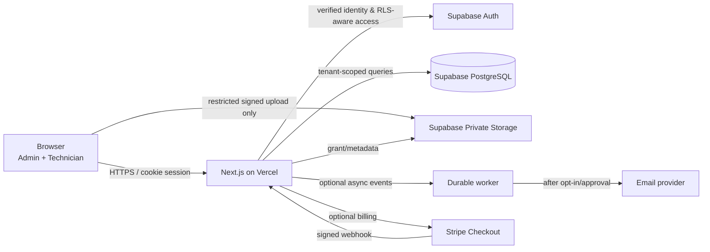

# Deployment Topology, Data Paths and Environments

**Proposed for Next.js stack; inspect actual code first.** Lovable/React-Vite/TanStack Start must have a revised ADR rather than pretending to use Next.js handlers.

The arrows represent *planned communication*, not evidence that these vendors are connected.

## Initial resource decisions

- One application deployment per **environment** (dev/staging/prod), not one per SaaS client.
- Staging and production must have separate Supabase databases, Auth users, object buckets and storage policies, secrets, email configuration and optional Stripe modes.
- Production hosting region/data residency needs agreement with client and provider settings; an EU database alone doesn't guarantee every external processor stays in the EU.
- Web server handles fast HTTP; scheduled notifications, imports, email, PDF generation move into durable jobs if scope requires.
- Map hostnames: `app.example.com` production and `staging.example.com` restricted staging (illustrative domains). Configure redirect URIs and webhook endpoints per env.

## Ownership

The SaaS operator controls deployment and code; each company controls its own tenant administration and business records under agreed terms. A bespoke client's app should use a separate repo/DB/deploy and account ownership contract; do not share unrelated client data in this SaaS.

## Production secrets

Use provider environment secret managers. Expose only publishable keys prefixed for client use. Privileged service-role and Stripe/webhook credentials are server-only and must not enter logs, browser bundles, AI prompts or git.
