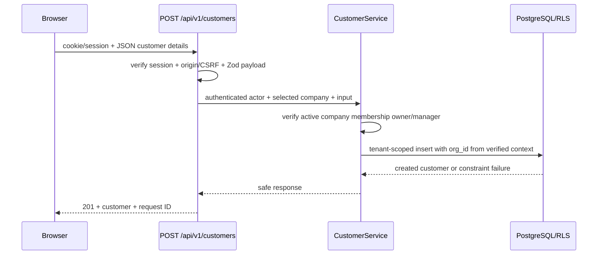
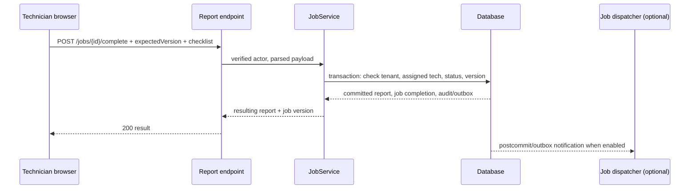

# AC Service Manager — Detailed System Communication

**Status: PROPOSED design, not implemented or verified.** First inspect the actual repo to confirm framework and backend. Next.js/Supabase is the assumed target. See `ARCHITECTURE.md`, `SECURITY.md`, `API_SPECIFICATION.md` and `PROJECT_STATE.md`.

## Component responsibilities

| Component | Owns | Never owns |
| --- | --- | --- |
| React Client Components | Input, UI state, accessible interactions | Role truth, service-role secrets, direct unrestricted writes |
| Next.js Server Components | Authenticated initial reads/HTML; call server services directly | Exposing DB privileged key to client |
| Next.js Route Handlers | REST contract, validated session/input, rate/CSRF protection, response envelope | Business logic copy-pasted from service functions |
| Application services | Authorisation, job transitions, transactions, due dates | Direct HTML/presentation |
| Repositories | Tenant-filtered data access, DB constraints | Trusting tenant ID alone |
| Supabase Auth | User identity and sessions | Application-level job permissions |
| PostgreSQL | Canonical relational records, RLS and FK constraints | Photo bytes and third-party API calls |
| Supabase private Storage | Job photos/PDF files | Deciding tenant roles from upload path alone |
| Durable job worker (later) | Reminder/import dispatch and retries | New unmanaged source of truth |
| External provider connectors (later) | Canonical mapping, auth, retries | Direct browser access to client provider secrets |

## Request 1: Create a customer

**Selected company context:** server checks the actor's active membership *on every operation*, not only during login. Company ID in URL/header/cookie is a selector, **not proof of authority**. Never use `supabase.auth.getSession()` alone as the server-side identity assurance without checking trusted auth state appropriately for installed SDK version.

## Request 2: Technician completes a service

Commit report, job status and next-due date in one consistent transaction. Make retries safe via idempotency key, unique `(organization_id, job_id, report_revision)` or equivalent constraint. No network email is sent inside the transaction.

## Request 3: Upload job photos

1. Browser POSTs proposed file metadata to `/api/v1/jobs/:id/attachments/grant`.
2. Server verifies job/tenant/role, MIME allowlist, claimed size, count and upload quota; creates server-generated object key and short-lived restricted upload grant.
3. Browser uploads directly to private storage using the grant.
4. Browser requests finalisation; backend checks object metadata/existence, authorised job association and DB record. Reject or clean up stale/unclaimed objects.
5. Download uses fresh authorised short-lived signed URL or protected server stream; never a global public bucket.

Scanning image files and preventing dangerous content is recommended if storing arbitrary attachments; initial pilot limit to JPEG/PNG/WebP and PDFs produced by your service, with server-side content and size validation.

## Request 4: CSV client import

Private temporary upload → parse safe CSV (not execute formula strings) → staged rows and normalised fields → preview + error counts → client signoff → idempotent batch commit under `organization_id` → reconciliation report → delete temporary source per retention policy. Import success is not the same as reconciliation success.

## Request 5: Billing / messaging (not required for pilot)

Stripe-hosted checkout → Stripe webhook raw body/signature verification → event dedupe → subscription projection → server-side feature entitlement. Client redirect has no authority. Reminder scanner checks due-date + contact permissions → unique delivery record → outbound email → store result and failure; duplicate events cannot send duplicates.

## End-to-end logging/tracing

Correlate request ID, job/event ID, environment and opaque tenant ID. Never log passwords, access tokens, full imported rows, customer addresses, private file URLs or medical/sensitive notes. Alert on cross-tenant-deny anomalies and failed jobs.
